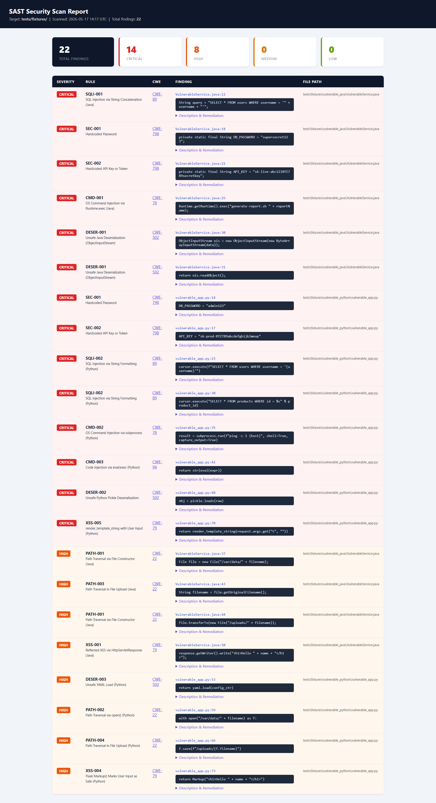

# sast-scanner-py

[](https://github.com/nicolasvl11/sast-scanner-py/actions/workflows/sast.yml)


A lightweight application security scanner combining **SAST** (static analysis of Java/Python
source) and **DAST** (dynamic black-box probing of a running app), with unified CVSS v3.1
scoring and OWASP Top 10 mapping. Zero external dependencies — pure Python standard library.

Findings appear inline in GitHub PRs via [GitHub Code Scanning](https://docs.github.com/en/code-security/code-scanning) (SARIF output).

---

## Demo



> HTML report with severity breakdown, CWE references, and expandable remediation guidance.

---

## Features

| Category | Rules | CWE |
|---|---|---|
| SQL Injection | String concatenation, f-strings, ORM bypass | CWE-89 |
| Hardcoded Secrets | Passwords, API keys, AWS credentials, JWT secrets, private keys | CWE-798, CWE-321 |
| Command Injection | `Runtime.exec`, `subprocess(shell=True)`, `os.system` | CWE-78 |
| Code Injection | `eval()`, `exec()`, `ScriptEngine.eval` | CWE-94 |
| Unsafe Deserialization | `ObjectInputStream`, `pickle.loads`, `yaml.load`, XStream | CWE-502 |
| Path Traversal | `new File(userInput)`, `open(request.args...)`, unsafe uploads | CWE-22 |
| XSS | `response.getWriter().write(+)`, `Markup(request.)`, `render_template_string`, `\|safe` | CWE-79 |

Findings are sorted by severity: **CRITICAL → HIGH → MEDIUM → LOW**

---

## Quick Start

### Option A — pip install
```bash
pip install git+https://github.com/nicolasvl11/sast-scanner-py.git
sast-scan ./my-project --format html --output report.html
```

### Option B — clone and run
```bash
# Clone and install
git clone https://github.com/YOUR_USERNAME/sast-scanner-py
cd sast-scanner-py
pip install -r requirements.txt

# Scan a directory (console output)
python cli.py /path/to/your/project

# Generate HTML report
python cli.py /path/to/your/project --format html --output report.html

# Generate JSON report (useful for CI/CD pipelines)
python cli.py /path/to/your/project --format json --output report.json

# Filter by minimum severity
python cli.py /path/to/your/project --severity HIGH
```

---

## Dynamic scanning (DAST) and unified reports

Beyond static analysis, the scanner can probe a **running** application over HTTP and
correlate both views. DAST catches classes of flaw that leave no static code signature —
broken object-level authorization (IDOR) and `alg:none` JWT bypasses — which SAST alone
cannot see. Findings from both engines are merged, scored with **CVSS v3.1**, and mapped
to the **OWASP Top 10**.

```bash
# Dynamic scan of a running target (8 probes, one per OWASP class)
python cli.py dast http://localhost:8080 --format html --output dast-report.html

# Unified SAST + DAST report
python cli.py unified \
  --sast-path ./src \
  --dast-url http://localhost:8080 \
  --format html --output appsec-report.html
```

Each finding carries a computed CVSS v3.1 base score (via `scanner/core/cvss.py`, a from-scratch
implementation of the official base-score equations) and its OWASP 2021 category. The DAST
probes use real black-box techniques: boolean/time-based injection, canary reflection,
differential authorization, and token forgery.

| Probe | Technique | CWE |
|---|---|---|
| DAST-SQLI | boolean true/false differential | CWE-89 |
| DAST-CMD | time-based blind (`; sleep N`) | CWE-78 |
| DAST-PATH | `/etc/passwd` canary | CWE-22 |
| DAST-IDOR | cross-user object access | CWE-639 |
| DAST-XSS | script canary reflection | CWE-79 |
| DAST-DESER | arbitrary-class resolution signature | CWE-502 |
| DAST-MISCONFIG | exposed actuator/env | CWE-200 |
| DAST-JWT | forged `alg:none` token | CWE-287 |

---

## Output Examples

### Console
```
SAST Scan Report — /path/to/project
────────────────────────────────────────────────────────────
✖ [CRITICAL] SQLI-001: SQL Injection via String Concatenation (Java)
  File   : VulnerableService.java:12
  CWE    : CWE-89
  Code   : String query = "SELECT * FROM users WHERE username = '" + username + "'";
  Issue  : SQL query built by concatenating user-controlled input...
  Fix    : Use PreparedStatement with parameterized queries...

  CRITICAL   3
  HIGH       4
  MEDIUM     1

  Total: 8 finding(s)
```

### HTML Report
Opens in any browser. Findings grouped by severity with expandable descriptions and remediation guidance.

### JSON Report
```json
{
  "scan_target": "/path/to/project",
  "scan_time": "2025-05-17T14:23:00Z",
  "summary": { "CRITICAL": 3, "HIGH": 4, "MEDIUM": 1, "LOW": 0 },
  "total": 8,
  "findings": [...]
}
```

---

## Architecture

```
sast-scanner-py/
├── cli.py                      # Entry point — scan / dast / unified subcommands
├── scanner/
│   ├── engine.py               # SAST file walker + rule matcher
│   ├── reporter.py             # SAST HTML/JSON/SARIF report generators
│   ├── rules/                  # SAST regex rules (SQLI, secrets, CMD, DESER, PATH, XSS)
│   ├── core/                   # Shared SAST + DAST layer
│   │   ├── findings.py         # UnifiedFinding model + CWE→OWASP/CVSS profiles
│   │   ├── cvss.py             # CVSS v3.1 base-score calculator (from scratch)
│   │   └── report.py           # Unified JSON/HTML/console reporting
│   └── dast/                   # Dynamic scanning
│       ├── client.py           # urllib HTTP client (zero deps)
│       ├── probes.py           # 8 probes, one per OWASP class
│       └── runner.py           # Probe orchestration
└── tests/
    ├── fixtures/               # Intentionally vulnerable code for SAST tests
    ├── test_rules.py           # SAST rule coverage
    ├── test_cvss.py            # CVSS calculator vs official scores
    ├── test_findings.py        # UnifiedFinding adapter/scoring
    └── test_dast_probes.py     # DAST probes (fake-client, vulnerable + secure)
```

Each rule is a simple dataclass with: ID, name, severity, CWE reference, description, remediation, and regex patterns. Adding a new rule is as simple as adding to the list in the relevant file.

---

## Running Tests

```bash
pytest tests/ -v
```

All rules are tested against intentionally vulnerable fixtures in `tests/fixtures/`.

---

## CI/CD Integration

The scanner exits with code `1` if any CRITICAL or HIGH findings are detected — making it easy to fail a pipeline:

```yaml
# GitHub Actions example
- name: SAST Scan
  run: |
    pip install -r requirements.txt
    python cli.py ./src --format json --output sast-report.json --severity HIGH

- name: Upload SAST Report
  uses: actions/upload-artifact@v4
  with:
    name: sast-report
    path: sast-report.json
```

---

## Extending the Scanner

Add a new rule in 3 steps:

1. Create (or add to) a rule file under `scanner/rules/`:
```python
Rule(
    id="XSS-001",
    name="Reflected XSS via Response Write",
    severity=Severity.HIGH,
    cwe="CWE-79",
    description="...",
    remediation="...",
    patterns=[r'response\.getWriter\(\)\.write\(.*request\.getParameter'],
    languages=[Language.JAVA],
)
```
2. Import the list into `scanner/rules/__init__.py`
3. Add a test in `tests/test_rules.py`

---

## Limitations

- Pattern-based (regex), not AST-based — may produce false positives on complex expressions
- Does not perform data-flow analysis (taint tracking)
- Designed for Java and Python; other languages require new parser mappings

---

## License

MIT
